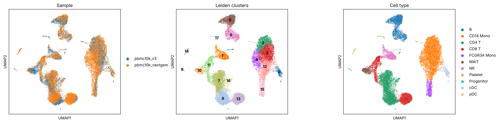
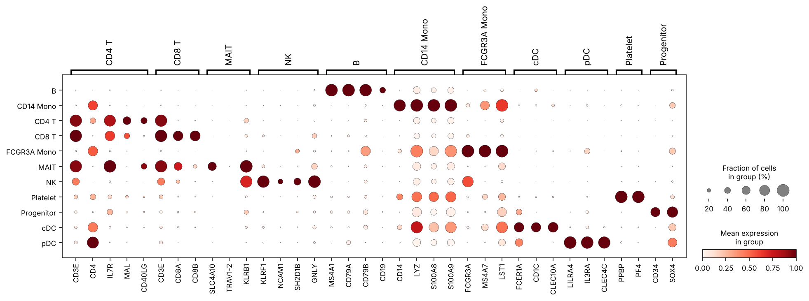
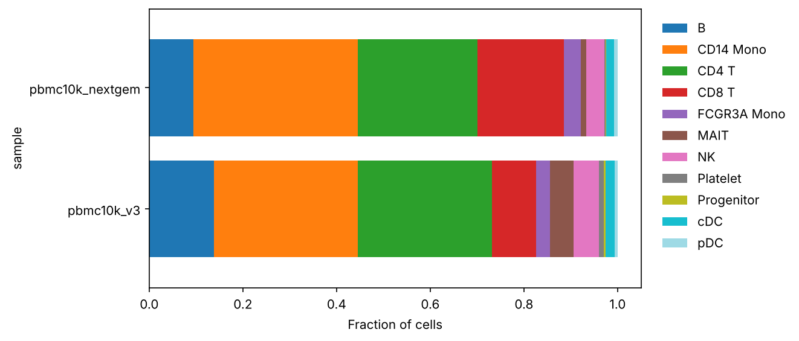

# scRNA-seq analysis pipeline

A clear, config-driven single-cell RNA-seq pipeline in Python, built on [Scanpy](https://scanpy.readthedocs.io). It goes from Cell Ranger count matrices to annotated cell types, and to a pseudobulk comparison of conditions (for example, vehicle vs. compound) within each cell type.

The demo runs on two public 10x Genomics PBMC datasets (about 24,000 cells from two donors and two chemistries) and finishes in about 5 minutes on a laptop.



## What the pipeline does

| Step | Method | Why |
|---|---|---|
| 1. Load | `samples.csv` lists each sample, its condition and its 10x `.h5` file | Add samples without editing code |
| 2. Cell QC | Per-sample outlier removal by median absolute deviation (MAD) on counts, genes, top-20-gene fraction and % mitochondrial reads | Adaptive cutoffs suit samples of different depth better than one fixed threshold |
| 3. Doublets | Scrublet, run separately in each sample | Doublets form false "intermediate" cell types |
| 4. Normalize | Library-size normalization, log1p, 2,000 highly variable genes (`seurat_v3`, batch-aware) | Standard practice; raw counts are kept in `layers["counts"]` for DE |
| 5. Integrate and cluster | PCA, Harmony across samples, kNN graph, UMAP, Leiden | Removes sample and chemistry effects while keeping biology |
| 6. Annotate | Wilcoxon cluster markers, then marker-gene scoring against the panel in `config.yaml` | Transparent labels you can check against the dot plot |
| 7. Compare conditions | Pseudobulk: sum raw counts per sample and cell type, then DESeq2 (PyDESeq2) | Treats the sample, not the cell, as the replicate, which avoids the inflated p-values of cell-level tests |

## Demo results

| Sample | Cells loaded | After QC | After doublet removal |
|---|---|---|---|
| pbmc10k_v3 | 11,769 | 10,237 | 9,757 |
| pbmc10k_nextgem | 11,996 | 10,966 | 10,426 |

Leiden found 18 clusters, which map onto 11 PBMC cell types. Both samples mix evenly in every cluster after Harmony (left panel above). The dot plot below shows that each label is backed by its canonical markers.



Points worth noting in the demo data:
- **Interferon-responsive monocytes.** Cluster 4 is a CD14 monocyte subset marked by *ISG15*, *MX1*, *IFIT3* and *TNFSF10*, so the pipeline separates activation states and not only lineages.
- **MAIT cells** (cluster 10; *SLC4A10*, *KLRB1*, *IL7R*) are split from conventional CD8 T cells.
- **Donor differences.** CD8 T cells make up 9% of cells in one donor and 18% in the other (`results/cell_type_composition.csv`). Composition shifts like this are what the pipeline measures in a treatment study.



The demo has one sample per donor and no treatment groups, so the pseudobulk DE step skips itself. It is tested on simulated data with a planted differentially expressed gene (`tests/test_pseudobulk.py`).

## Run it

```bash
conda env create -f envs/environment.yml
conda activate scrnaseq
bash scripts/download_demo_data.sh   # about 75 MB
python run_pipeline.py --config config/config.yaml
pytest tests
```

Outputs go to `results/`:
- `figures/`: QC before and after, UMAPs, marker dot plot, composition, volcano plots
- `cluster_markers.csv`: top 50 markers per cluster with log fold change and % expressing
- `cluster_annotation_scores.csv`: marker score of each cell type in each cluster
- `cell_type_composition.csv`: cell type fractions per sample
- `pseudobulk_de.csv`: DESeq2 results per cell type, when conditions have replicates
- `processed.h5ad`: the annotated AnnData object (not committed because of its size)
- `summary.json`: cell counts at each step and the cluster labels

## Use it on your own study

1. Run Cell Ranger and point `config/samples.csv` at each `filtered_feature_bc_matrix.h5`.
2. Set `condition` per sample (for example `vehicle`, `compound_1uM`) and set `pseudobulk_de.reference: vehicle`.
3. Use at least 2 samples per condition, ideally 3 or more. Pseudobulk DE runs in every cell type with enough cells.
4. Edit the marker panel in `config.yaml` for your tissue.

## Project layout

```
config/       config.yaml (all parameters) and samples.csv
src/scpipe/   io.py, qc.py, analysis.py, pseudobulk.py, plots.py
run_pipeline.py
tests/        pseudobulk unit tests on simulated counts
results/      figures and tables from the demo run
```

## Data

10x Genomics public datasets: "10k PBMCs from a Healthy Donor (v3 chemistry)" (Cell Ranger 3.0.0) and "10k Human PBMCs, 3' v3.1, Chromium X" (Cell Ranger 6.1.0).

## License

MIT
